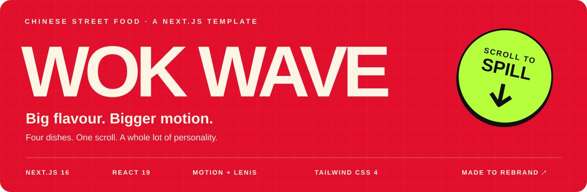
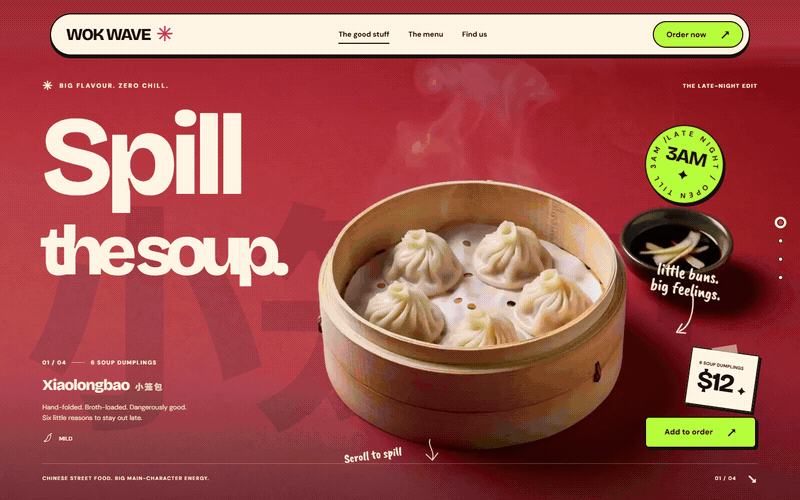
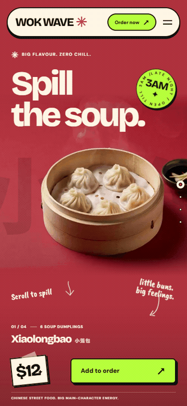
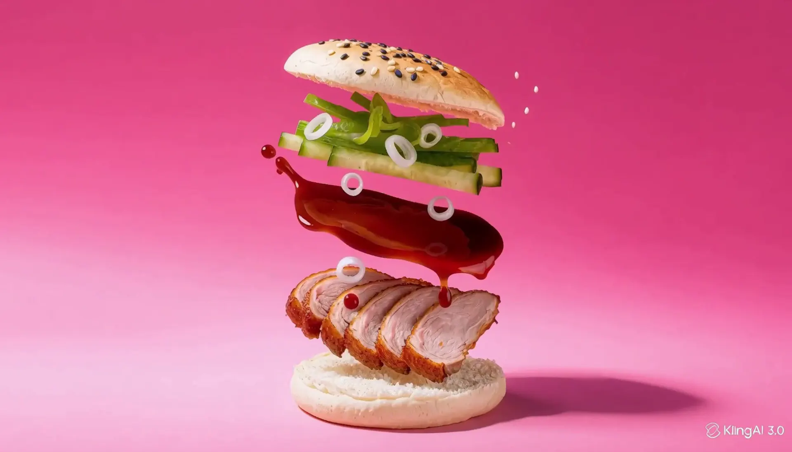
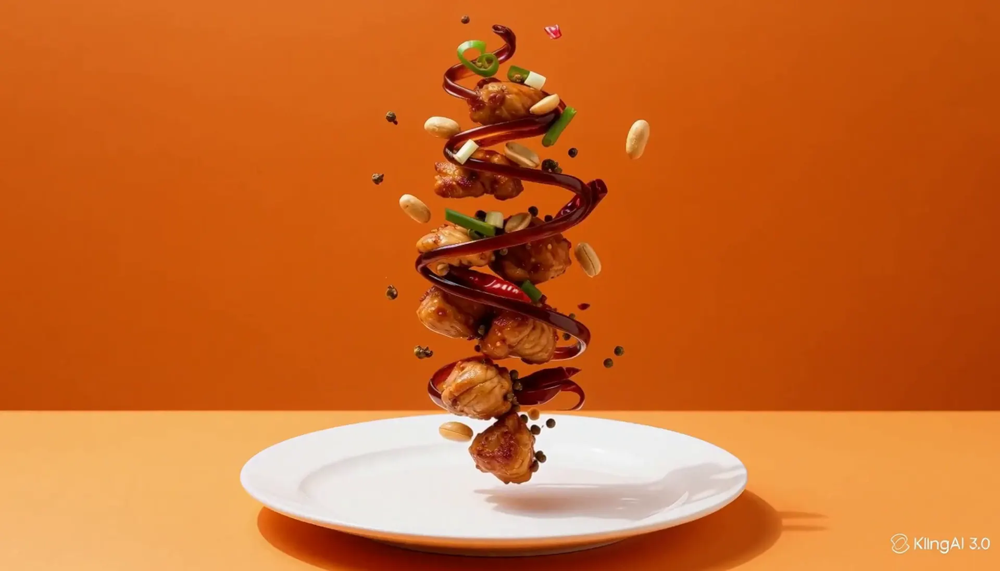

<div align="center">



**A bold Chinese street-food website with scroll-driven food animation.**

Next.js 16 · React 19 · TypeScript · Tailwind CSS 4 · Motion · Lenis

[Watch the preview](#a-little-scroll-a-lot-of-flavour) · [Get started](#running-in-two-commands) · [Make it yours](#one-file-your-entire-restaurant) · [Technical guide](docs/GUIDE.md) · [QA report](QA-REPORT.md)

</div>

## A little scroll. A lot of flavour.

**[Watch the 1080p website showcase →](showcase/WOK-WAVE-website-showcase-1080p.mp4)** — a 49-second silent video with desktop animations, the photo menu and mobile views.

Soup dumplings rise. Noodles unravel. Duck bao opens up. Kung pao brings the heat. Four food sequences turn the menu into a story, with oversized type, ingredient callouts and a different colour world for every dish.



<sub>Actual site screenshots sampled at settled scroll positions, played as a looping GIF. This illustrates the design and sequence; it is not a real-time performance recording. [View a still preview](docs/media/desktop-still.png).</sub>

## Small screen. Same appetite.

<table>
<tr>
<td width="40%" align="center">

</td>
<td width="60%" valign="middle">
<h3>Built for thumbs and hungry eyes.</h3>
<p><strong>Responsive food framing.</strong><br />Separate mobile frame sets, a focused crop and compact ingredient labels.</p>
<p><strong>A proper mobile menu.</strong><br />Native navigation dialog, keyboard dismissal and clear ordering links.</p>
<p><strong>Motion is a preference.</strong><br />Reduced-motion mode serves static exploded posters, removes pinned animation and requests no sequence frames.</p>
<p><a href="docs/media/mobile-still.png">Open the mobile still →</a></p>
</td>
</tr>
</table>

## Four dishes. Four personalities.

| 🥟 Xiaolongbao | 🍜 Dan Dan Noodles |
| :--- | :--- |
|  |  |
| **Spill the soup.** Rich red. Soup-filled dumplings. | **Main character noodles.** Electric lime. Noodles with attitude. |

| 🦆 Peking Duck Bao | 🌶️ Kung Pao Chicken |
| :--- | :--- |
|  |  |
| **Duck, but make it a bao.** Soft pink. Stacked flavour. | **Heat check.** Hot orange. A fiery finish. |

## What comes in the box

| Experience | Included |
| :--- | :--- |
| **Scroll storytelling** | Four sticky canvas sequences, held endpoints, eased progress and colour handoffs. |
| **Brand personality** | Oversized typography, Chinese ghost lettering, ingredient leaders, marquees, a rotating badge and desktop chili cursor. |
| **A working menu** | 14 photographed sample dishes, six category tabs, heat levels, vegetarian markers and keyboard navigation. |
| **Visit & order** | Address, opening hours, map, booking, Instagram and external ordering links. |
| **Media delivery** | Worker-based decoding and drawing, bounded bitmap caches, lazy loading and device-specific WebP sequences. |
| **The essentials** | Responsive layouts, reduced-motion support, social metadata and Restaurant structured data. |
| **The handoff** | Source assets, generated frames, extraction scripts, configuration reference and reproducible QA reports. |

## Running in two commands

**Requires Node.js 24+ and npm.** From the project directory:

```sh
npm ci
npm run dev
```

Open **[localhost:3000](http://localhost:3000)**. All frame sequences and the subset Chinese font are already generated. A clean build needs internet access for the Google font build step.

For a production preview:

```sh
npm run build
npm run start
```

No environment variables are required for the supplied demo.

## One file. Your entire restaurant.

Start with **[`src/site.config.ts`](src/site.config.ts)**. The branding, copy, dishes, menu and business details live together.

| Make it yours | Change these fields |
| :--- | :--- |
| Name, tone & labels | `name`, `chineseName`, `tagline`, `description`, `ui` |
| Brand colours | `colors` |
| Menu & pricing | `menu`, `dishes`, `currency`, `locale` |
| Menu photos | `menu[].image`; generated originals and exact prompts in `assets-src/menu/` |
| Dish composition | `headlineLayout`, `displaySize`, `mobileDisplaySize`, `focalX`, ingredient anchors |
| Orders & bookings | `orderUrl`, `bookingUrl` |
| Location & socials | `address`, `hours`, `openingHours`, `mapUrl`, `instagramUrl` |
| Production metadata | `url` |

**Before launch:** replace the sample business details, prices and action URLs. Ordering and booking use external providers; the template does not include a checkout or reservation backend. Complete the [license terms and media-rights review](LICENSE-NOTE.md) before selling or redistributing it.

### Bring your own food

1. Add your video to `assets-src/videos/<dish-id>.mp4`.
2. Update its entry in `src/site.config.ts`.
3. Generate the delivery assets:

```sh
npm run frames -- xiaolongbao
npm run fonts
```

Then apply the sampled backdrop colours, position the ingredient labels and verify desktop and mobile crops. The [full asset workflow](docs/GUIDE.md#replace-or-add-a-dish) explains masks, source proportions and payload budgets.

## The motion, under the hood

```text
Scroll position → Motion + Lenis → Eased frame target
                                         ↓
                           Worker + bounded bitmap cache
                                         ↓
                              OffscreenCanvas → Your dish

Reduced motion → Static exploded poster + visible ingredient labels
```

The site draws image sequences instead of seeking a video. Desktop uses 128 frames per dish; mobile uses 96. A worker handles decoding and canvas drawing, while offscreen sections release cached media. Canvas pixel density is capped at 2.

| Dish | Desktop sequence | Mobile sequence |
| :--- | ---: | ---: |
| Xiaolongbao | 5.387 MB | 1.672 MB |
| Dan Dan Noodles | 4.505 MB | 1.499 MB |
| Peking Duck Bao | 6.634 MB | 2.171 MB |
| Kung Pao Chicken | 5.868 MB | 1.931 MB |

<sub>Decimal MB, excluding posters and masks. Visitors receive the appropriate device set. Source sampling is 16 fps desktop / 12 fps mobile; render-loop frequency is a separate measurement.</sub>

Read the [scroll-engine documentation](docs/GUIDE.md#scroll-engine) for loading order, easing, memory budgets and handoffs.

## Measured, with the details attached

**Local mobile Lighthouse snapshot · 21 October 2026 UTC**

| Performance | Accessibility | Best practices | SEO |
| :---: | :---: | :---: | :---: |
| **93** | **100** | **100** | **100** |

Build and type checking passed. The recorded functional audit passed 24 dish/viewport checks and 12 functional checks, with no reported page errors or horizontal overflow. Six lifecycle checks also passed.

**Known performance limit:** the 60 fps gate under 4× CPU throttling was **not met**. The latest recorded run measured about 28.9 fps on desktop and 26.4 fps on mobile. A separate 2× run reached about 60 fps; that does not establish a 4× pass. Results are local lab measurements, not guarantees for every device.

[Full QA findings](QA-REPORT.md) · [Lighthouse data](qa/lighthouse-mobile.json) · [Functional checks](qa/functional-report.json) · [4× benchmark](qa/checkpoint-a.json)

<details>
<summary><strong>Run the checks yourself</strong></summary>

Start the production server, then run these in another terminal, one at a time:

```sh
npm run typecheck
npm run qa
node scripts/lifecycle-qa.mjs
npm run benchmark
npm run audit:mobile
```

The benchmark exits nonzero if its performance gate fails. See the [QA guide](docs/GUIDE.md#qa-and-audits) for methodology and the separate 2× comparison.

</details>

<details>
<summary><strong>Supplied footage: documented exceptions</strong></summary>

The owner approved using the supplied footage unchanged. All four videos are eight-second, 24 fps, **1344×768** sources, rather than 1080p or exact 16:9. Extraction preserves their proportions; upscaling adds no source detail.

Dan Dan, duck bao and kung pao contain visible generated-video watermarks in some frames. Kung pao also has a horizon line, and the backdrops vignette and change over time. These characteristics remain visible in the template and previews. No watermark removal or source-video editing was performed.

</details>

## Find your way around

```text
src/site.config.ts      ← Start here: brand, copy, menu and links
src/app/                App Router, metadata, fonts and global styles
src/components/         Dish stages, navigation, menu, visit and footer
src/lib/                Frame lifecycle and motion preferences
public/                 Delivery frames, posters, masks and canvas worker
assets/                 Original supplied media
assets-src/videos/      Named inputs for the extraction pipeline
scripts/                Asset generation, QA, previews and packaging
docs/                   Technical guide and animated README media
qa/                     Measurements, reports and screenshots
```

**Deploy:** commit the generated public assets and font, import the project into Vercel as Next.js, select Node.js 24 and use `npm run build`. Set your production origin and business links first. [Deployment guide →](docs/GUIDE.md#deploy-to-vercel)

**Refresh these animations:** with the local site running, use `node scripts/readme-media.mjs`. It captures the real UI using Chrome and creates looping GIFs with the bundled ffmpeg. Chrome must be installed; no additional npm dependencies are needed.

---

<div align="center">

**WOK WAVE**<br />
Big flavour. Bigger motion.

[Start building ↑](#running-in-two-commands) · [Technical guide](docs/GUIDE.md) · [License note](LICENSE-NOTE.md)

</div>
